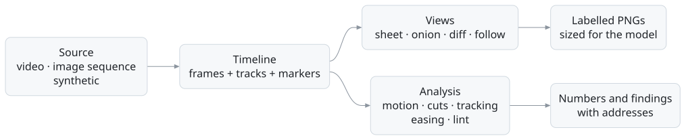
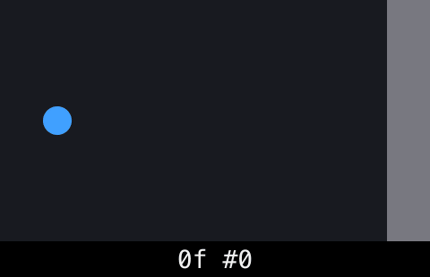
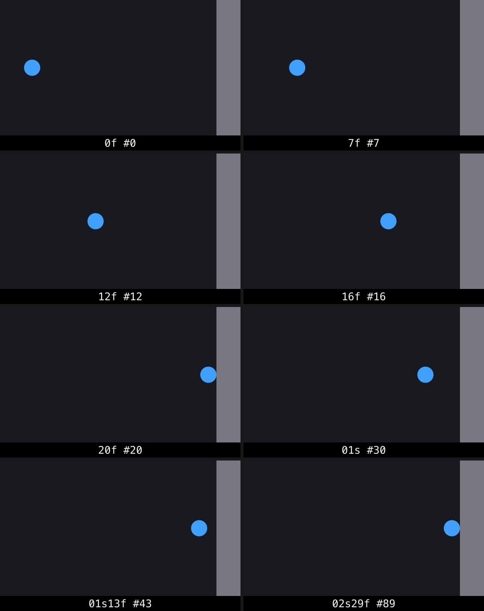
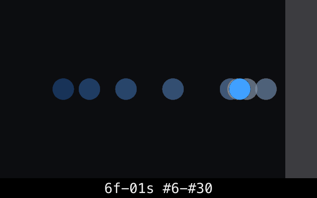
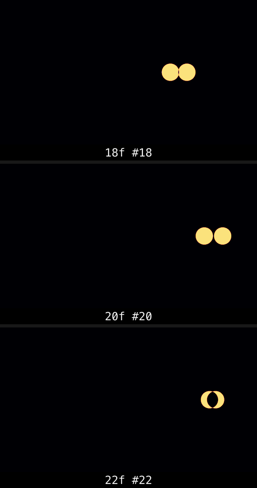

<p align="center">
  
</p>

<p align="center">
  <strong>Motion perception for AI agents.</strong><br>
  kymo lets an agent see and measure anything that moves (video, animation, synthetic scenes) as labelled frames and real numbers.<br>
  It's for people building agents that review animations, debug video, or prove a motion change worked.
</p>

<p align="center">
  <a href="https://github.com/tylergibbs1/kymo/actions/workflows/ci.yml"></a>
  <a href="LICENSE"></a>
  
  
  <a href="https://github.com/tylergibbs1/kymo/commits/main"></a>
</p>

<p align="center">
  <a href="#quick-start"><strong>Quick start</strong></a> ·
  <a href="#use-it-from-an-agent-mcp"><strong>Add to Claude</strong></a> ·
  <a href="skills/kymo/SKILL.md"><strong>Agent skill</strong></a> ·
  <a href="eval/README.md"><strong>Eval results</strong></a> ·
  <a href="CONTRIBUTING.md"><strong>Contribute</strong></a>
</p>

## How it works

A still frame hides motion: you can't see the timing, spacing or easing between frames. kymo turns every source into a **Timeline**, frames and numeric tracks on one clock, and gives every frame one address. That address is the same in the image label, the JSON and the file name, so an agent can quote back exactly what it saw.

<picture>
  <source media="(prefers-color-scheme: dark)" srcset="docs/images/how-it-works-dark.svg">
  
</picture>

An agent follows four steps, and each step is one call:

| 1. The clip                                                                     | 2. `scan`: where does it change?                                                                                                 | 3. `frames --view onion`: what path?                                                                            | 4. `frames --view diff`: what moved?                                                       |
| ------------------------------------------------------------------------------- | -------------------------------------------------------------------------------------------------------------------------------- | --------------------------------------------------------------------------------------------------------------- | ------------------------------------------------------------------------------------------ |
|  |  |  |  |

Then `track` measures it: the ball first touches the wall at `20f #20`, and `check` can assert that, e.g. `@impact1 within #18..#22`. See the [skill](skills/kymo/SKILL.md) for the full loop.

### Frame addresses

| Write            | Means                                |
| ---------------- | ------------------------------------ |
| `08s10f`         | 8 seconds and 10 frames (canonical)  |
| `02m00s24f`      | 2 minutes, 0 seconds and 24 frames   |
| `#250`           | frame index 250                      |
| `8.33s`, `500ms` | a time, rounded to the nearest frame |
| `-1f`            | the last frame                       |
| `@impact1+5f`    | five frames after a marker           |
| `2s..4s:2f`      | a range, every second frame          |
| `clip1@08s10f`   | an address on a named source         |

On variable-frame-rate footage and GIFs, seconds are real time and frames are decoded frames: `16s` is the frame on screen at 16 s, `-1f` the last frame, and labels show each frame's own start time (`16.04s #350`), so a label never disagrees with `t`.

## Features

- 🎞️ **Contact sheets sized for the model.** Up to 12 labelled frames per image, sized to `high-res` (≤2576 px, ≤4784 visual tokens) or `standard` (≤1568 px, ≤1568 tokens), so cost is known before rendering. Frames are never upscaled, labels sit under the frame and are at least 28 px tall.
- 🧅 **Views that show motion between frames.** `onion` blends frames into one cell to show path and spacing, `diff` heatmaps what changed, `follow` crops a region over time, `compare` puts two sources side by side at the same moments (matched by time when their frame rates differ), `plot` charts numeric tracks.
- 📈 **Numbers, not guesses.** `track` follows a box and returns `x`, `y`, `w`, `h` per frame, then fits the easing (`linear`, CSS presets, `cubic-bezier(...)`, or a spring with stiffness and damping). Synthetic sources return exact ground-truth tracks.
- ✂️ **Finds what changes.** `scan` measures motion energy, finds hard cuts and fades, and spends its frame budget where things move. Cuts and peaks become markers you can address, like `@cut1`.
- 🔍 **Lint rules and assertions.** `check` finds duplicated, dropped and black frames, flicker, things leaving the safe area, and curves that reverse. Assertions read like the question:
  ```sh
  kymo check clip1 --assert "box.x <= 600 at 1s" --assert "@impact1 within #18..#22"
  ```
- 🤝 **Agent-friendly contract.** stdout carries only JSON: `open`, `probe`, `scan`, `track`, `record` and `schema` print one JSON value; `frames`, `compare` and `check` print JSON Lines, one sheet or finding per line and then a summary line (`kymo schema <command>` describes both under `lines`). Errors go to stderr as `{tag, message, hint}`, with a hint that says how to fix them (`"8s10" is not an address. Use 08s10f, #250, 8.33s…`). Exit codes: 0 done, 1 a `check` that did not pass (its result is still printed), 2 bad input, 3 source not found, 4 adapter unavailable, 5 timeout, 6 backend failure. Flags are only ever added, and `kymo schema` prints every input and output JSON Schema.
- 🖼️ **Images an API accepts.** Every image stays under 3.75 MB (5 MB as base64); a sheet of noisy footage is re-encoded with a palette, then scaled down, until it fits. A custom target can set its own `maxBytes`.
- 🧪 **An eval decides the design.** 42 synthetic tasks and 87 tasks on UI animations captured in a real browser, all with ground truth, an agent loop for Claude, and A/B experiments for sheet size, cells per sheet, label style, sampling, tool examples and text format. [Read more](eval/README.md).

## Quick start

You need Node 24, [Bun](https://bun.sh) and ffmpeg. Bun installs and runs the scripts; kymo itself runs on Node.

```sh
brew install ffmpeg            # or: sudo apt install ffmpeg
git clone https://github.com/tylergibbs1/kymo && cd kymo
bun install
bun run --silent kymo -- scan "synthetic:bounce?impact=20" --budget 8
```

Point it at your own video the same way: `bun run --silent kymo -- probe clip.mp4`. More commands are in the [video reference](skills/kymo/references/video.md).

### Use it from an agent (MCP)

Add the server to Claude Code, Claude Desktop or any MCP client, using the path to your clone:

```json
{
  "mcpServers": {
    "kymo": { "command": "node", "args": ["/path/to/kymo/apps/cli/bin/kymo.js", "mcp"] }
  }
}
```

It exposes seven tools: `kymo_probe`, `kymo_scan`, `kymo_frames`, `kymo_compare`, `kymo_track`, `kymo_check` and `kymo_record`. Use `kymo mcp --http :3917` for Streamable HTTP. Give your agent [the skill](skills/kymo/SKILL.md) so it knows the workflow.

## Status

kymo is at v0. Video, image sequences and synthetic scenes work today. Web/UI animation (Playwright), telemetry, live camera and screen buffers, Remotion and Lottie are next; `kymo_record` returns a clear "not available yet" error until live sources land.

## Contributing

Contributions are welcome, from bug reports to new source adapters.

- Read the [contributing guide](CONTRIBUTING.md) to set up and run the tests and eval.
- Pick up a [good first issue](https://github.com/tylergibbs1/kymo/labels/good%20first%20issue) to start small.
- Everyone involved follows the [Code of Conduct](CODE_OF_CONDUCT.md): be kind, assume good intent, critique the work and not the person.
- Settle design arguments with an experiment in the [eval](eval/README.md), not a long thread.

## License

[MIT](LICENSE)
